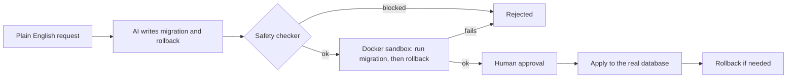

# Database Architect AI

Describe a database change in plain English. An AI writes the migration and its rollback, a safety checker and a throw-away Docker sandbox test it, and a person approves it before it touches the real database.

> Example: *"Add a user_tier column to users"* becomes a checked `ALTER TABLE`, a rollback, a sandbox test report, and an approval step.

## How it works



Every step is only allowed from the right status (`CHECKED -> SANDBOXED -> APPROVED -> APPLIED`). A migration cannot reach the real database without being checked, tested and approved. Every action is written to an audit log.

## What is inside

| Part | What it does |
|---|---|
| Schema reader | Reads tables, columns, keys, indexes and constraints with a read-only account that cannot even read rows |
| Safety checker | Parses SQL (not text search) and stops `DROP TABLE`, `TRUNCATE`, `DELETE/UPDATE` without a real `WHERE`, and warns about table locks (non-concurrent index, constraint without `NOT VALID`, and more) |
| AI agent | Local model (Ollama). Asks, validates, safety-checks, and sends problems back to the AI to fix |
| Rollback check | Runs migration then rollback and compares the schema before and after |
| Docker sandbox | A temporary PostgreSQL container with a copy of the structure. Always deleted afterwards |
| Approval and apply | Status rules, advisory lock (one migration at a time), `lock_timeout`, retries, all-or-nothing transactions, audit log |
| Chunked backfill | Updates big tables in small batches. Progress is saved with the data, so it can stop and continue |
| API | FastAPI with API key, WebSocket live status, and CORS for a frontend |
| Evaluation | 50 tasks that measure how often the agent is right |

## Results

Measured with `qwen2.5-coder:3b` (a small local model), temperature 0, on 50 tasks (42 migrations and 8 dangerous requests).

| | v1 | v2 |
|---|---|---|
| All tasks correct | 40 / 50 (80%) | 49 / 50 (98%) |
| Migration tasks correct end-to-end (SQL parts and sandbox) | 79% | 98% |
| Dangerous requests refused or stopped | 88% | 100% |

What changed from v1 to v2: the schema is shown to the AI as `bigserial` instead of `nextval(...)` (the AI was copying it wrongly), warnings with one clear fix are sent back to the AI, and requests that change data rows are refused (migrations change structure only).

**Read this carefully:** v2 was improved by looking at the failures of the same 50 tasks, so the 98% is optimistic. The tasks were written by the author. A separate set of new tasks has not been run yet. Full results are in `evals/results/`.

## Run it (Windows PowerShell)

```
python -m venv .venv
.venv\Scripts\Activate.ps1
pip install -r requirements.txt
copy .env.example .env
docker compose up -d
python -m scripts.seed
python -m scripts.setup_readonly
pytest
```

You also need [Ollama](https://ollama.com) with a model: `ollama pull qwen2.5-coder:3b`.

**Command line**

```
python -m app new "Add a user_tier column to users"
python -m app sandbox 1
python -m app approve 1
python -m app apply 1
python -m app rollback 1
```

**API:** `uvicorn app.api.main:app --reload`, then open http://127.0.0.1:8000/docs and press Authorize (the key is `API_KEY` in `.env`).

**Measure quality:** `python -m evals.run_eval --label v3`

## Limitations

- **The sandbox has structure only, no table data.** It proves that the migration and rollback work, not how long they take on a big table.
- PostgreSQL only.
- A small local model is used. It sometimes forgets safe patterns (one task still fails because it leaves out `CONCURRENTLY`). A bigger model should do better, but this has not been measured.
- The evaluation tasks are self-written and the model was tuned on them (see Results).
- Backfills work on tables with a single whole-number primary key, and only change rows (no deletes).
- Security is one shared API key. There are no user accounts yet.
- The sandbox tests run on a developer computer. The GitHub Actions run skips them.

## Project layout

```
app/db/          schema reader, schema diff, rollback check
app/safety/      parser-based safety rules
app/llm/         AI client, prompts, agent loop
app/sandbox/     Docker sandbox
app/migrations/  status rules, apply, rollback, audit log
app/backfill/    batch updates
app/api/         FastAPI
evals/           50 tasks and the runner
tests/           160 tests
```
